<p align="center">
  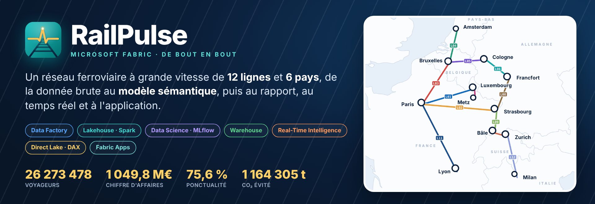
</p>

<h1 align="center">🚄 RailPulse · Projet Microsoft Fabric de bout en bout</h1>

<p align="center">
  <b>De la donnée brute au modèle sémantique, puis au rapport Power BI, au temps réel et à l'application Fabric Apps.</b><br>
  Data Engineering · Data Science · Data Warehouse · Real-Time Intelligence · Power BI · Fabric Apps.<br>
  Un seul espace de travail. Toutes les charges de travail de Fabric. Un guide public pour tout reconstruire.
</p>

<p align="center">
  
  
  
  
  
  
  
  
  
  
</p>

<p align="center">
  <a href="docs/RailPulse_Guide_Fabric_Public.pdf"><b>📘 Guide pas à pas (PDF)</b></a> ·
  <a href="docs/RPT_RailPulse.pdf"><b>📊 Rapport Power BI (PDF)</b></a> ·
  <a href="modele-semantique/"><b>🧠 Modèle sémantique</b></a> ·
  <a href="application/"><b>📱 Application</b></a> ·
  <a href="https://www.linkedin.com/in/abdoul-hamid-diallo-fabric-data-engineer/"><b>💼 LinkedIn</b></a>
</p>

<p align="center">
  Réalisé par <b>Abdoul Hamid Diallo</b>, Microsoft Data &amp; AI Engineer, titulaire de <b>7 certifications Microsoft</b><br>
        
</p>

---

## 🏗️ Architecture

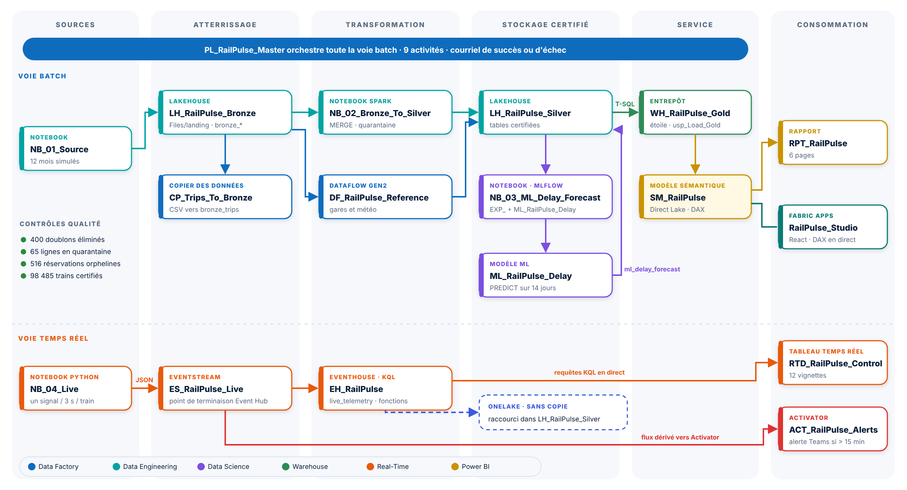

**RailPulse** est un opérateur ferroviaire européen fictif : **12 lignes à grande vitesse**, **12 gares**, **6 pays**, de Paris à Amsterdam, Zurich et Milan. Ce dépôt contient toute sa plateforme de données, construite dans un seul espace de travail Microsoft Fabric, sur une capacité d'essai.

Ingénierie des données, **science des données**, entrepôt, temps réel et décisionnel y travaillent sur une seule copie des données. Deux voies cohabitent et se rejoignent dans OneLake :

- **La voie batch** raconte les douze derniers mois. Un pipeline maître enchaîne simulation de la source, ingestion, contrôle qualité, **data science** (un modèle de machine learning qui prévoit les retards) et chargement d'un entrepôt en étoile, que lit un modèle sémantique Direct Lake.
- **La voie temps réel** raconte le présent. Chaque train en circulation émet sa position toutes les trois secondes ; Eventstream, Eventhouse et KQL en font une salle de contrôle, et Activator prévient dès qu'un train dépasse 15 minutes de retard.

---

## 📊 Aperçu du rapport

| Réseau | Ponctualité |
|---|---|
| 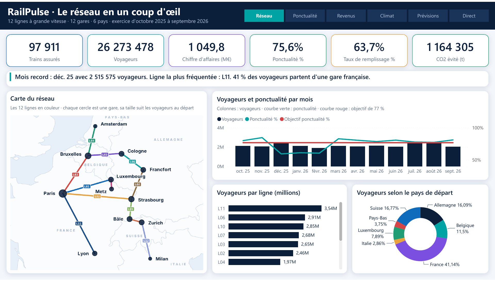 | 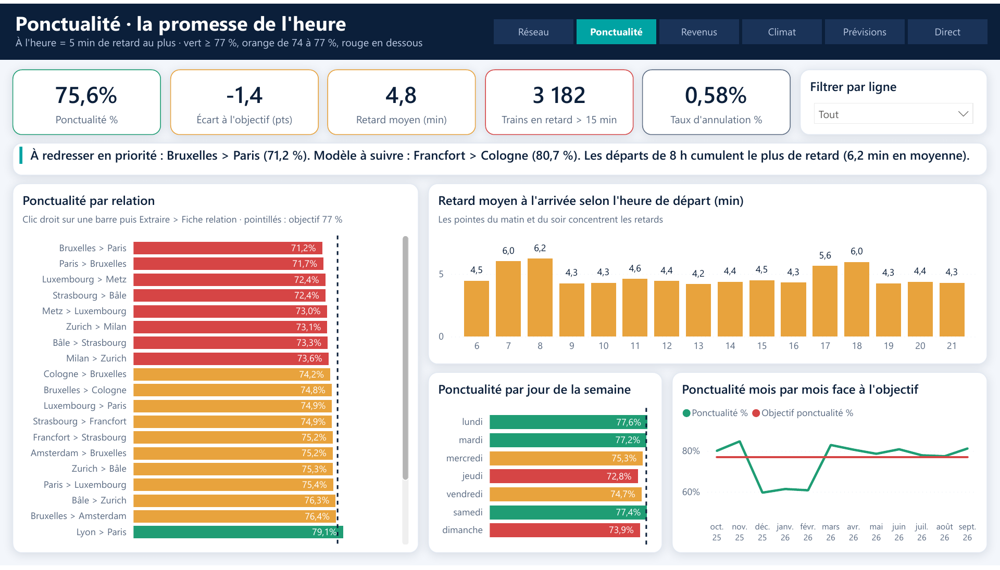 |
| **Revenus** | **Climat** |
| 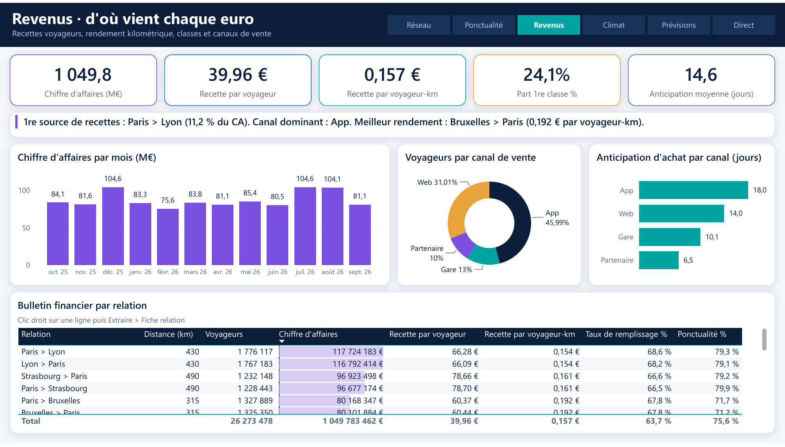 | 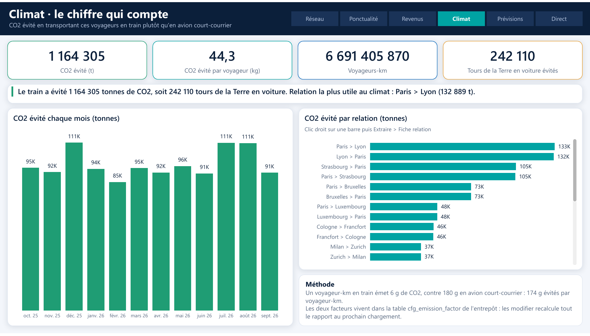 |
| **Prévisions** | **Direct** |
| 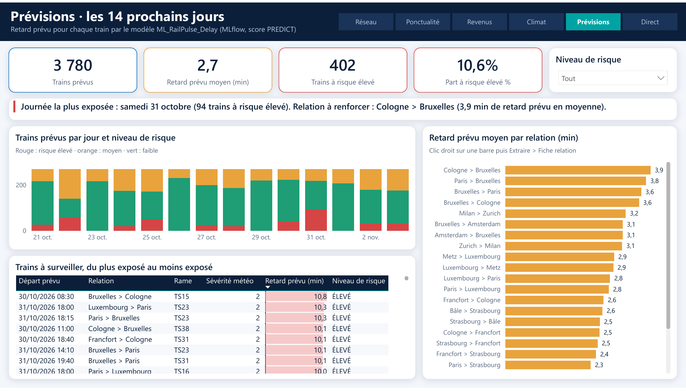 | 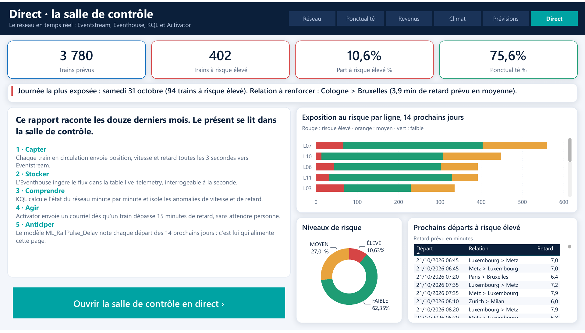 |

👉 Le rapport complet en haute définition : [`docs/RPT_RailPulse.pdf`](docs/RPT_RailPulse.pdf)

---

## 🎯 Résultats clés

| Domaine | Indicateur | Valeur |
|---|---|---|
| 🚆 Volumes | Trains assurés sur l'exercice | **97 911** |
| | Voyageurs transportés | **26 273 478** |
| | Taux de remplissage | **63,7 %** |
| ⏱️ Qualité | Ponctualité (5 minutes au plus) | **75,6 %** pour un objectif de 77 % |
| | Retard moyen à l'arrivée | **4,8 min** |
| | Taux d'annulation | **0,58 %** |
| 💶 Finance | Chiffre d'affaires | **1 049,8 M€** |
| | Recette par voyageur | **39,96 €** |
| | Part de la première classe dans les recettes | **24,1 %** |
| 🌍 Climat | CO₂ évité face à l'avion | **1 164 305 tonnes** |
| | Équivalent | **242 110 tours de la Terre en voiture** |
| 🔮 Prévisions | Départs notés par le modèle sur 14 jours | **3 780** |
| | Départs à risque élevé | **402** (10,6 %) |
| 🧪 Qualité des données | Lignes brutes refusées par la couche Silver | **981** (400 doublons, 65 lignes défectueuses, 516 réservations orphelines) |

---

## 💼 Impact métier

- **Une seule vérité, sans copie.** Le lakehouse, l'entrepôt, le modèle sémantique, le rapport et l'application lisent les mêmes fichiers Delta de OneLake. Personne ne réconcilie deux chiffres.
- **La direction sait où agir.** Bruxelles > Paris est la relation à redresser (71,2 % de ponctualité), Francfort > Cologne le modèle à suivre (80,7 %), et les départs de 8 h concentrent le plus de retard (6,2 min en moyenne).
- **L'exploitation anticipe au lieu de subir.** Le modèle de machine learning désigne chaque matin les départs à risque des 14 prochains jours : samedi 31 octobre ressort comme la journée la plus exposée, avec 94 trains à risque élevé.
- **L'incident est vu à la seconde.** Un train à l'arrêt en pleine voie apparaît sur la carte de la salle de contrôle, et Activator envoie l'alerte dans Microsoft Teams sans attendre personne.
- **L'argument climat est chiffré.** 44,3 kg de CO₂ évités par voyageur : un chiffre que le marketing, la RSE et la direction peuvent citer, recalculé à chaque chargement.

---

## 🧭 Synthèse

| Question | Réponse apportée par la plateforme |
|---|---|
| Combien de voyageurs, et où ? | Décembre 2025 est le mois record avec 2 515 575 voyageurs ; la ligne L11 Paris ⇄ Lyon est la plus fréquentée ; 41 % des voyageurs partent d'une gare française. |
| D'où viennent les recettes ? | Paris > Lyon pèse 11,2 % du chiffre d'affaires ; l'application mobile est le premier canal de vente ; Bruxelles > Paris offre le meilleur rendement (0,192 € par voyageur-km). |
| Tient-on la promesse de l'heure ? | Pas encore : 75,6 % contre 77 % visés, soit 1,4 point d'écart. Lundi, mardi et samedi passent l'objectif ; jeudi et dimanche sont les jours les plus faibles. |
| Que va-t-il se passer ? | Le modèle prévoit 2,7 min de retard moyen sur les 14 prochains jours ; Cologne > Bruxelles est la relation à renforcer. |
| Que se passe-t-il maintenant ? | La salle de contrôle temps réel affiche chaque train, son retard et sa vitesse, et isole les arrêts en pleine voie. |

---

## 🔁 Pipeline

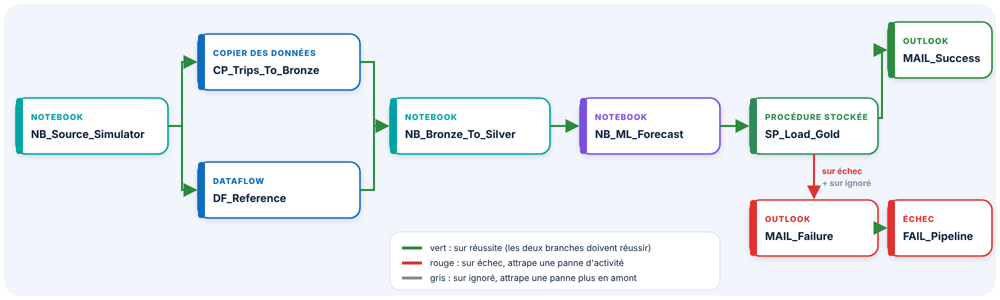

Le même pipeline, tel qu'il tourne dans Fabric :

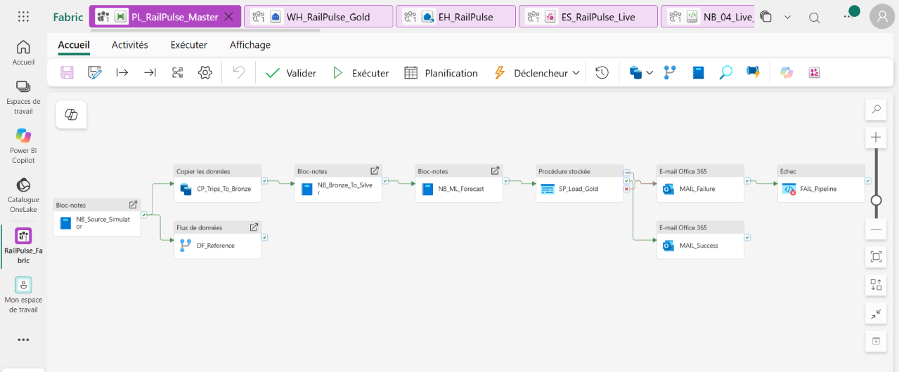

`PL_RailPulse_Master` enchaîne **9 activités** : le notebook source, un **Copy** générique (`landing/trips/*.csv`) en parallèle d'un **Dataflow Gen2**, le notebook Bronze vers Silver, le notebook de machine learning, la **procédure stockée** de chargement Gold, puis deux courriels **Outlook** et une activité **Échec**.

La branche d'erreur est branchée sur *échec* **et** *ignoré* : une panne survenue n'importe où dans la chaîne déclenche le courriel, et l'activité `Échec` garde l'exécution en rouge dans le hub de surveillance. Les notebooks ont deux nouvelles tentatives espacées de 120 secondes. Définition complète : [`pipeline/`](pipeline/).

---

## 🧬 Lignage

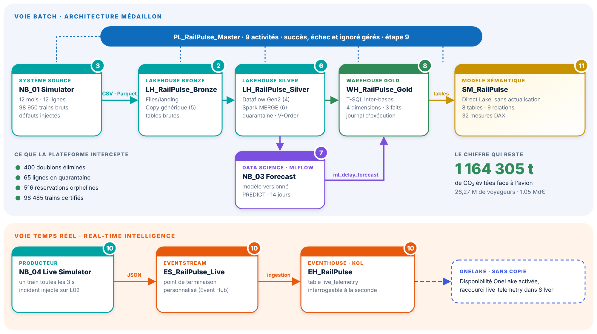

Chaque pastille numérotée renvoie à l'étape du guide qui construit le bloc.

| Couche | Élément Fabric | Ce qui s'y passe | Volume |
|---|---|---|---|
| Source | `NB_01_Source_Simulator` | simule 12 mois d'exploitation avec des défauts volontaires | 98 950 trains bruts |
| 🥉 Bronze | `LH_RailPulse_Bronze` | fichiers bruts dans `Files/landing`, tables `bronze_*` chargées par Copy et Spark | 98 950 · 781 102 |
| 🥈 Silver | `LH_RailPulse_Silver` | dédoublonnage, quarantaine, `MERGE` Delta, intégrité référentielle, V-Order, références via Dataflow Gen2 | 98 485 · 780 586 |
| 🧪 Data Science | `NB_03` · `EXP_RailPulse_Delay` · `ML_RailPulse_Delay` | entraînement suivi par MLflow, modèle versionné, score `PREDICT` | 3 780 prévisions |
| 🥇 Gold | `WH_RailPulse_Gold` | schéma en étoile par T-SQL inter-bases, sans copie, journal d'exécution | 4 dimensions · 3 faits |
| 🧠 Sémantique | `SM_RailPulse` | Direct Lake, 9 tables, 10 relations, 50 mesures | aucune actualisation |
| 📊 Usage | `RPT_RailPulse` · `RailPulse_Studio` | rapport de 6 pages et application web | lecture en direct |
| ⚡ Temps réel | `ES_` · `EH_` · `RTD_` · `ACT_` | flux, base KQL, salle de contrôle, alertes | un signal toutes les 3 s |

Les données brutes sont fournies dans [`data/`](data/) avec leur dictionnaire.

---

## 🧠 Modèle sémantique

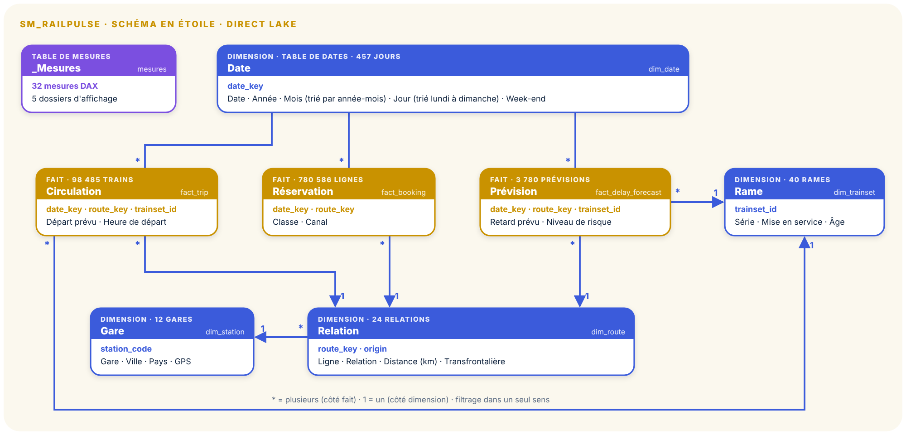

`SM_RailPulse` est un modèle **Direct Lake** : Power BI lit directement les fichiers Delta de l'entrepôt, sans importation ni actualisation planifiée. Trois faits (`Circulation`, `Réservation`, `Prévision`) partagent quatre dimensions (`Date`, `Relation`, `Gare`, `Rame`). Les colonnes techniques sont masquées, les noms sont métier et en français, et toutes les mesures sont rangées dans `_Mesures`, en sept dossiers.

Le dépôt fournit le modèle de deux façons :

- [`SM_RailPulse_Mesures.dax`](modele-semantique/SM_RailPulse_Mesures.dax) : les **32 mesures essentielles** créées en **une seule requête DAX**, qui affiche en plus les chiffres de contrôle ;
- [`SM_RailPulse.SemanticModel/`](modele-semantique/SM_RailPulse.SemanticModel/) : la définition **TMDL** complète du modèle déployé, avec ses **50 mesures**.

```dax
Écart à l'objectif (pts) =
    IF ( NOT ISBLANK ( [Ponctualité %] ), ( [Ponctualité %] - [Objectif ponctualité %] ) * 100 )

Tours de la Terre en voiture évités =
    DIVIDE ( [CO2 évité (t)] * 1000000, 120 * 40075 )
```

---

## ⚡ Temps réel


| Élément | Rôle |
|---|---|
| `NB_04_Live_Simulator` | envoie la position, la vitesse et le retard de chaque train toutes les 3 secondes, avec un incident simulé sur la ligne L02 |
| `ES_RailPulse_Live` | reçoit le flux sur un point de terminaison personnalisé (Event Hub) |
| `EH_RailPulse` | table `live_telemetry`, fonctions KQL, vue matérialisée, disponibilité OneLake |
| `RTD_RailPulse_Control` | salle de contrôle en 12 vignettes, dont la carte de la dernière position de chaque train |
| `ACT_RailPulse_Alerts` | alerte Microsoft Teams dès qu'un train dépasse 15 minutes de retard |

```kql
// Le réseau en direct : dernière position de chaque train et sa classe de retard
LiveWindow(5)
| summarize arg_max(ts, *) by train_id
| extend etat = case(delay_min > 15, "Retard critique", delay_min > 5, "En retard", "A l'heure")
```

L'alerte reçue dans Microsoft Teams quand l'incident simulé de la ligne L02 dépasse 15 minutes de retard :

<p align="center"></p>

Fonctions, requêtes du tableau de bord et définition complète : [`temps-reel/`](temps-reel/).

---

## 🧪 Data Science : prévoir les retards des 14 prochains jours

La partie Data Science transforme douze mois d'historique en une **prévision opérationnelle** : chaque départ des deux semaines à venir reçoit un retard prévu et un niveau de risque, que lisent le rapport, l'application et l'exploitation. Tout le cycle de vie du modèle se fait dans Fabric, sans quitter l'espace de travail.

| Étape du cycle | Ce qui est fait dans Fabric |
|---|---|
| 1 · Préparation | un jeu de caractéristiques commun à l'historique et à l'horaire futur, calculé en PySpark sur le lakehouse Silver |
| 2 · Expérimentation | expérience **MLflow** `EXP_RailPulse_Delay` : paramètres, métriques et modèle journalisés à chaque exécution |
| 3 · Évaluation | comparaison à une référence naïve (la médiane) sur une période de test jamais vue |
| 4 · Enregistrement | modèle versionné `ML_RailPulse_Delay`, avec sa signature d'entrée |
| 5 · Industrialisation | score par lots avec **`PREDICT`** (SynapseML) dans le pipeline, résultats écrits en Delta et métriques historisées dans `ml_model_metrics` |

| Le modèle | Choix |
|---|---|
| Cible | retard à l'arrivée, en minutes |
| Caractéristiques | heure de départ, jour, mois, pointe, distance, relation transfrontalière, météo la plus sévère aux deux gares, âge de la rame, remplissage |
| Algorithme | `HistGradientBoostingRegressor`, perte `absolute_error` |
| Validation | découpage **temporel** : entraînement jusqu'à fin juillet 2026, test sur août et septembre |
| Résultat | **MAE proche de 2,6 min contre 3,4 min** sans modèle, environ 22 % d'erreur en moins |
| Mise en production | expérience MLflow `EXP_RailPulse_Delay`, modèle enregistré `ML_RailPulse_Delay`, score par lots avec `PREDICT` |
| Sortie | niveau de risque FAIBLE (moins de 3 min), MOYEN (3 à 6 min) ou ÉLEVÉ (6 min et plus) pour chacun des 3 780 départs des 14 prochains jours : 402 sont à risque élevé |

---

## 📱 Application Fabric Apps

| Voie 1 · Réseau | Voie 2 · Ponctualité |
|---|---|
| 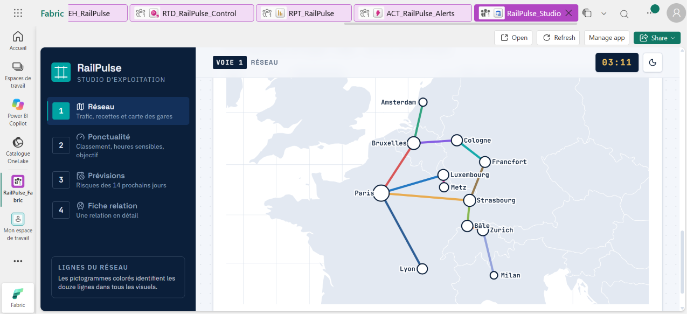 | 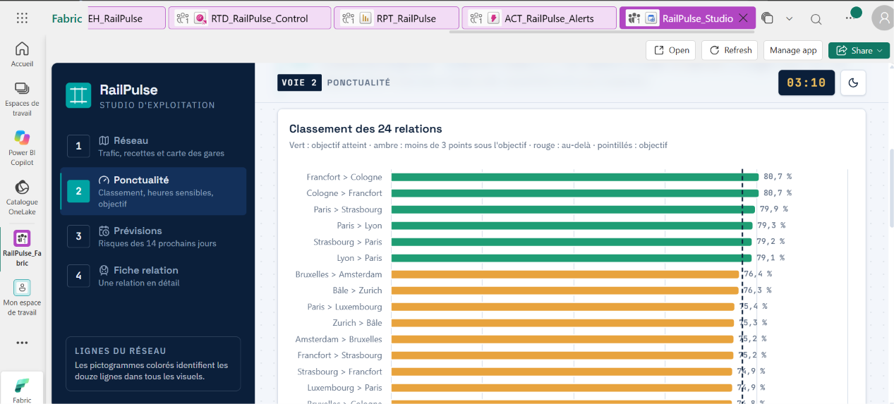 |
| **Voie 3 · Prévisions** | **Voie 4 · Fiche relation** |
| 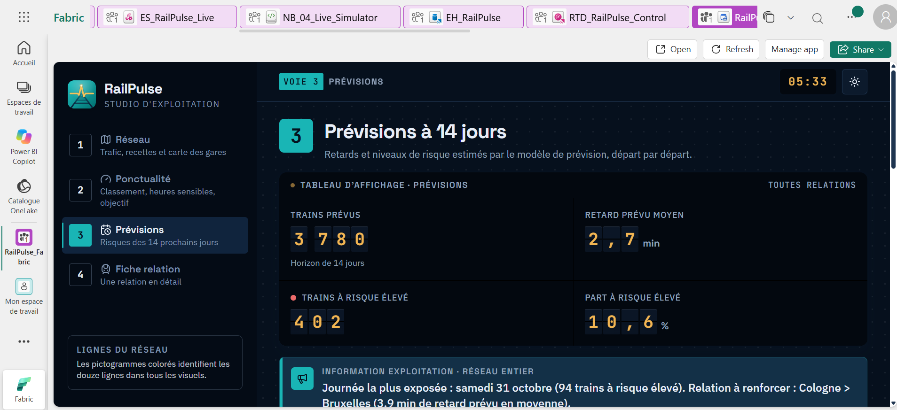 | 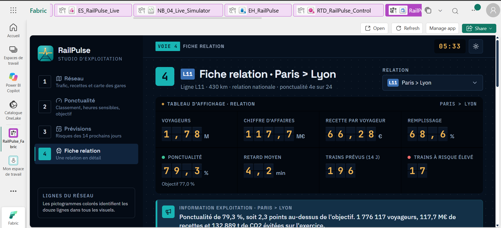 |

<details>
<summary><b>🖼️ Voir les onze visuels de l'application</b></summary>

| | |
|---|---|
| **Voie 1 · Réseau · Voyageurs par ligne** | **Le réseau en carte** |
| 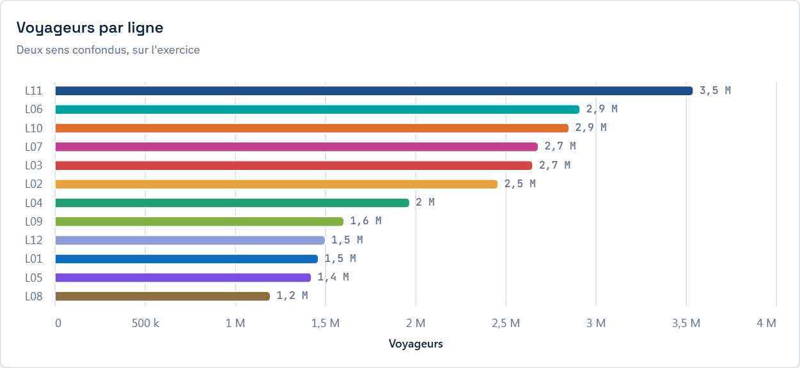 | 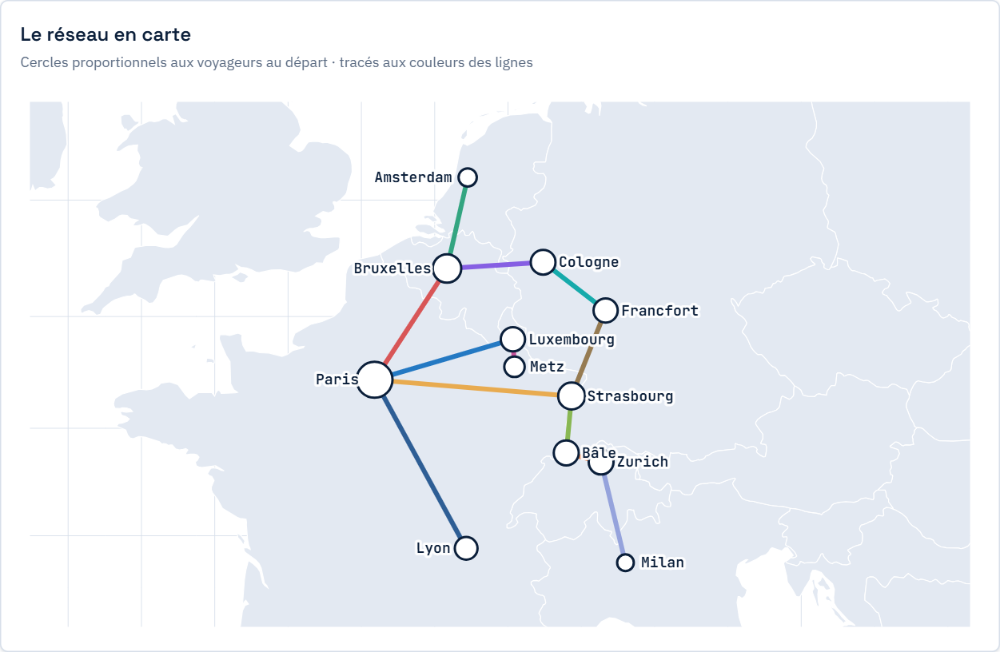 |
| **Voie 1 · Réseau · Voyageurs et ponctualité, mois par mois** | **Voie 2 · Ponctualité : classement des 24 relations** |
| 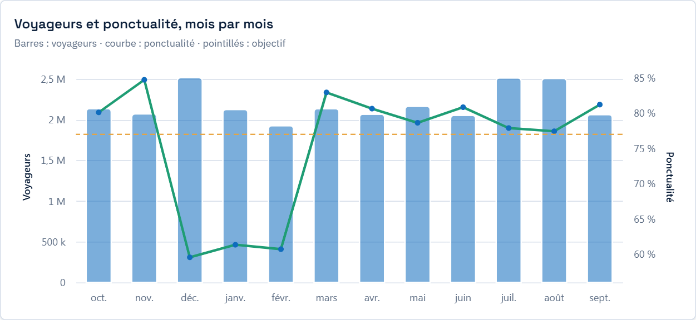 | 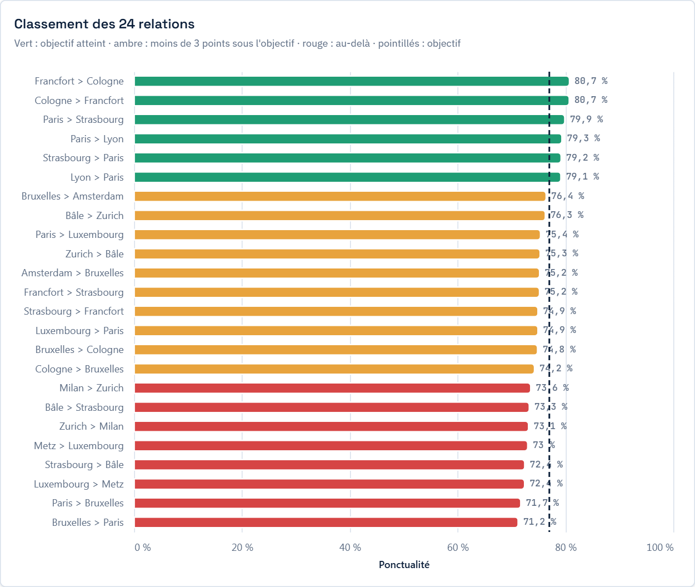 |
| **Voie 2 · Ponctualité · Heures sensibles de la semaine** | **Retard moyen par heure de départ** |
| 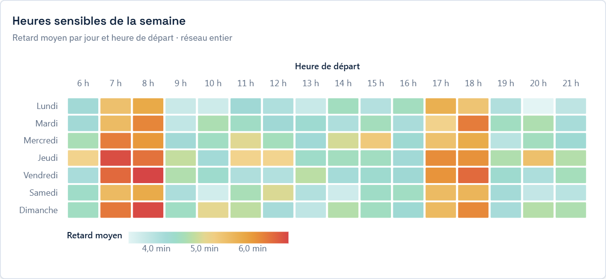 | 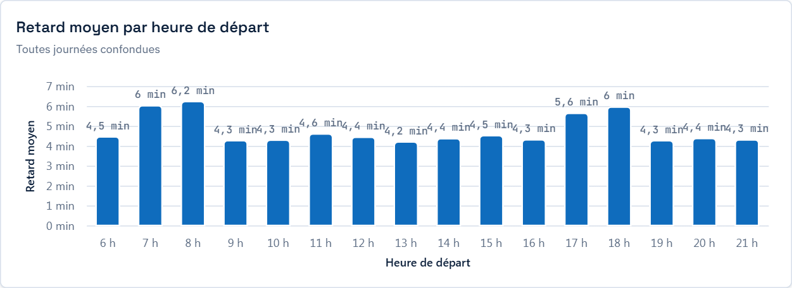 |
| **Voie 3 · Prévisions · Trains prévus par jour et niveau de risque** | **Tableau des départs à surveiller** |
| 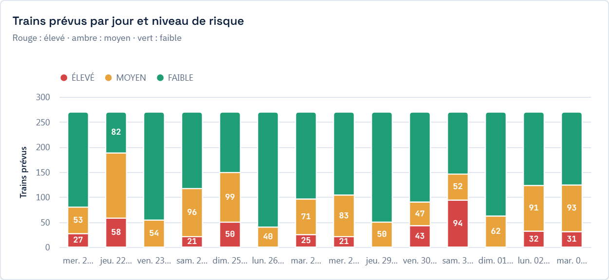 | 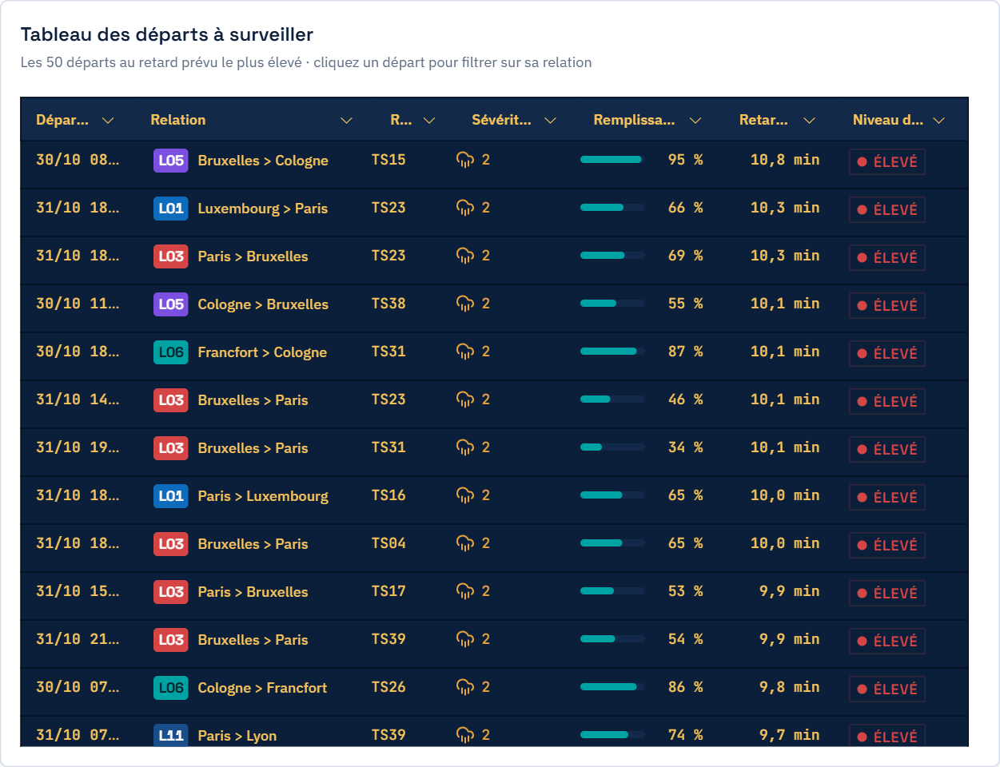 |
| **Voie 4 · Fiche relation (Paris > Lyon) · Voyageurs et ponctualité, mois par mois** | **Retard moyen par heure de départ** |
| 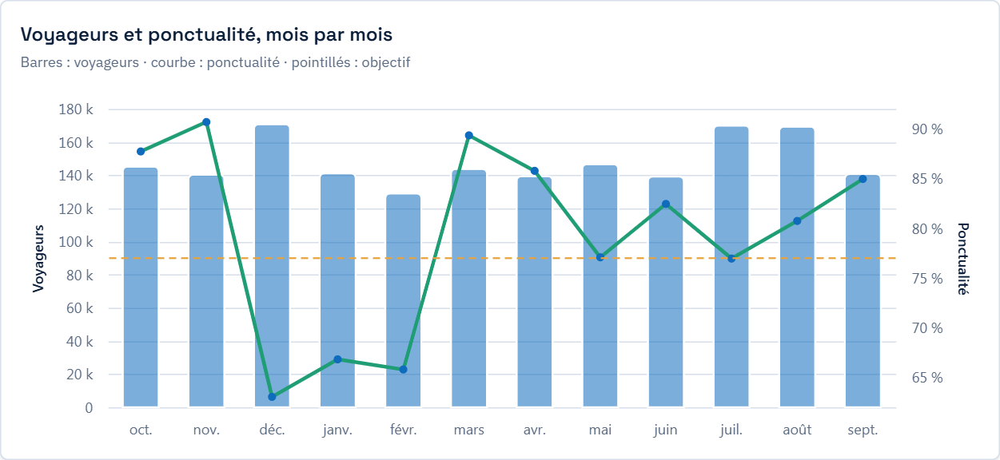 | 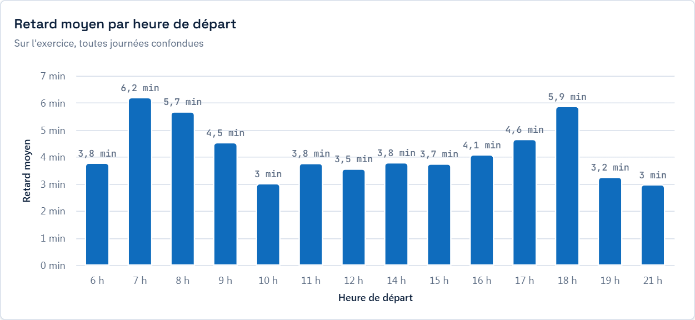 |
| **Voie 4 · Fiche relation · Prochains départs prévus** | |
| 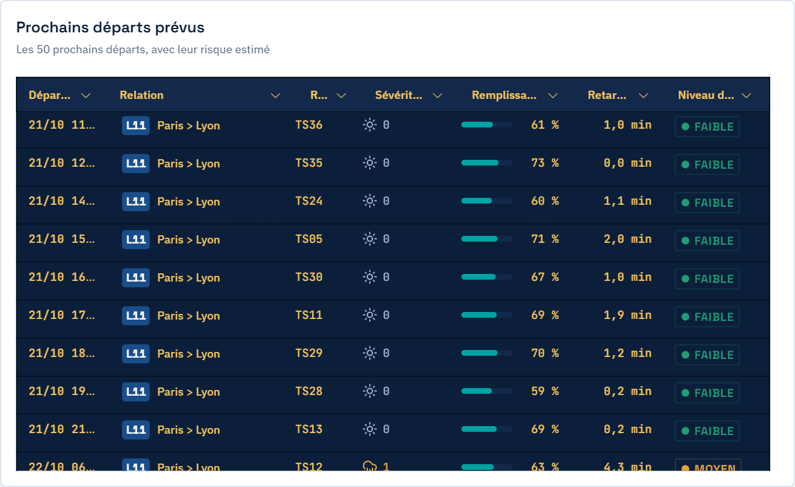 | |

</details>

**RailPulse Studio** est une application React hébergée **dans** l'espace de travail Fabric. Elle interroge `SM_RailPulse` en DAX, en direct, avec les droits de l'utilisateur connecté : quatre voies (Réseau, Ponctualité, Prévisions, Fiche relation), un tableau d'affichage à volets façon gare, une carte du réseau, un mode clair et un mode sombre. Code source et déploiement : [`application/`](application/).

---

## 📘 Le guide pas à pas

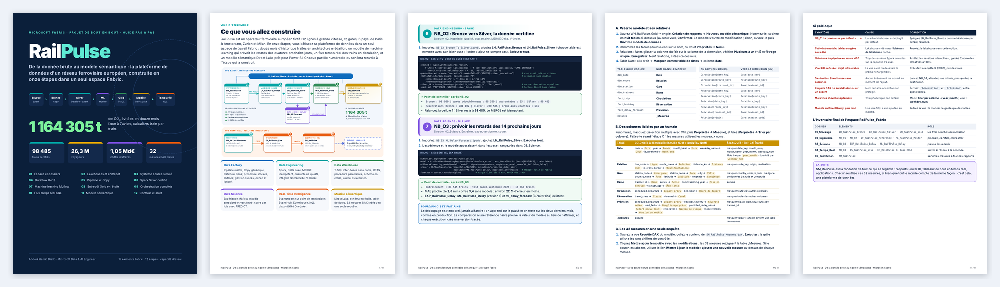

[`RailPulse_Guide_Fabric_Public.pdf`](docs/RailPulse_Guide_Fabric_Public.pdf) reconstruit toute la plateforme, **de l'espace de travail jusqu'au modèle sémantique**, en **12 étapes** et 12 pages. Chaque étape donne quoi cliquer, les valeurs à saisir, les chiffres à retrouver et un encadré *Pourquoi c'est fait ainsi*. Un tableau *Si ça bloque* traite les situations qu'on rencontre réellement sur une capacité d'essai.

| | Étapes |
|---|---|
| Fondations | 1 Espace et dossiers · 2 Lakehouses et entrepôt · 3 Système source simulé |
| Ingestion | 4 Dataflow Gen2 · 5 Pipeline et Copy · 6 Spark Silver certifié |
| Valeur | 7 Machine learning MLflow · 8 Entrepôt Gold en étoile · 9 Orchestration complète |
| Temps réel et sémantique | 10 Flux temps réel KQL · 11 Modèle sémantique · 12 Contrôle et arrêt |

---

## 🗂️ Organisation du dépôt

```text
railpulse-fabric-end-to-end/
├── README.md
├── docs/
│   ├── RailPulse_Guide_Fabric_Public.pdf   guide pas à pas, 12 étapes
│   ├── RPT_RailPulse.pdf                   rapport Power BI, 6 pages
│   ├── diagrammes/                         architecture, lignage, pipeline, schéma en étoile (SVG et PNG)
│   └── images/                             rapport, application, captures Fabric, guide
├── data/landing/                           zone d'atterrissage : CSV, Parquet, JSON + dictionnaire
├── notebooks/                              NB_01 à NB_04 (.ipynb)
├── dataflow/                               DF_RailPulse_Reference (Power Query M)
├── pipeline/                               PL_RailPulse_Master (JSON)
├── entrepot/                               WH_RailPulse_Gold (T-SQL : tables, procédure, vues)
├── temps-reel/                             KQL, fonctions, tableau de bord temps réel
├── modele-semantique/                      32 mesures en une requête DAX + modèle TMDL complet
├── rapport/                                RPT_RailPulse (définition PBIR)
└── application/                            RailPulse Studio (Fabric Apps, React)
```

Chaque dossier a son propre README.

---

## 🚀 Reproduire le projet

1. Activez une capacité Fabric (l'essai gratuit suffit) et ouvrez le [guide](docs/RailPulse_Guide_Fabric_Public.pdf).
2. Créez l'espace de travail, les deux lakehouses et l'entrepôt (étapes 1 et 2).
3. Importez les quatre notebooks de [`notebooks/`](notebooks/) et exécutez le scénario du guide, étape par étape.
4. Exécutez [`entrepot/WH_RailPulse_Gold.sql`](entrepot/WH_RailPulse_Gold.sql), puis le pipeline complet.
5. Créez le modèle sémantique depuis l'entrepôt et collez [`SM_RailPulse_Mesures.dax`](modele-semantique/SM_RailPulse_Mesures.dax) dans la vue *Requête DAX*.
6. Vérifiez les chiffres de contrôle : **26 273 478** voyageurs, **1 049,78 M€**, **75,56 %**, **1 164 305 t**, **3 780** trains prévus.

Le générateur utilise une graine fixe : tout le monde obtient les mêmes volumes.

---

## 🧰 Stack technique

| Charge de travail Fabric | Éléments | Technologies |
|---|---|---|
| OneLake | lakehouses, entrepôt, raccourci | Delta Lake, V-Order, disponibilité OneLake |
| Data Factory | `PL_RailPulse_Master`, `DF_RailPulse_Reference` | Copy générique, Dataflow Gen2 (Power Query M), procédure stockée, Outlook, Échec |
| Data Engineering | `LH_RailPulse_Bronze`, `LH_RailPulse_Silver`, `NB_01`, `NB_02` | PySpark, `MERGE` Delta, quarantaine qualité, `OPTIMIZE ... VORDER` |
| Data Science | `NB_03`, `EXP_RailPulse_Delay`, `ML_RailPulse_Delay` | scikit-learn, MLflow, `PREDICT` (SynapseML) |
| Data Warehouse | `WH_RailPulse_Gold` | T-SQL inter-bases, CTAS, procédure paramétrée, vues |
| Real-Time Intelligence | `ES_RailPulse_Live`, `EH_RailPulse`, `RTD_RailPulse_Control`, `ACT_RailPulse_Alerts` | Event Hub, KQL, vue matérialisée, détection d'anomalies, Activator |
| Power BI | `SM_RailPulse`, `RPT_RailPulse` | Direct Lake, DAX, TMDL, PBIR |
| Fabric Apps | `RailPulse_Studio` | React 19, TypeScript, Vite, Tailwind CSS, Vega-Lite, `@microsoft/fabric-app-data` |

---

## ✅ Conclusion

RailPulse montre ce que Microsoft Fabric change concrètement : une plateforme complète, du système source à l'application métier, tient dans **un seul espace de travail**, sur **une seule copie des données**, et se reconstruit à l'identique en suivant un guide. L'ingénierie des données (Spark, Delta, qualité), l'analytique (étoile, Direct Lake, DAX), la science des données (MLflow) et le temps réel (KQL, Activator) ne sont plus quatre projets à intégrer : ce sont quatre vues sur OneLake.

## 💡 Mot de la fin

> Une donnée n'a de valeur que si elle répond à une question avant qu'on la pose. RailPulse répond à quatre : que s'est-il passé, pourquoi, que va-t-il se passer, et que se passe-t-il maintenant.

---

## 👤 Auteur

**Abdoul Hamid Diallo** · Microsoft Data & AI Engineer

      

### 🏅 Certifications Microsoft

| Certification | Examen | Niveau |
|---|---|---|
| Microsoft Certified: Fabric Analytics Engineer Associate | **DP-600** | Associate |
| Microsoft Certified: Fabric Data Engineer Associate | **DP-700** | Associate |
| Microsoft Certified: Power BI Data Analyst Associate | **PL-300** | Associate |
| Microsoft Certified: Azure AI Engineer Associate | **AI-102** | Associate |
| Microsoft Certified: Azure Data Scientist Associate | **DP-100** | Associate |
| Microsoft Certified: Azure AI Fundamentals | **AI-900** | Fundamentals |
| Microsoft Certified: Azure Data Fundamentals | **DP-900** | Fundamentals |

[](https://www.linkedin.com/in/abdoul-hamid-diallo-fabric-data-engineer/)
[](https://github.com/abdoulhamiddiallo)

*RailPulse est un opérateur fictif. Les gares et leurs coordonnées sont réelles ; toutes les autres données sont simulées.*
