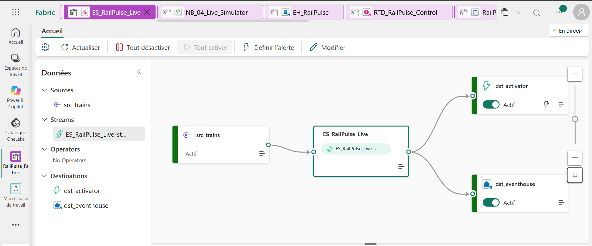
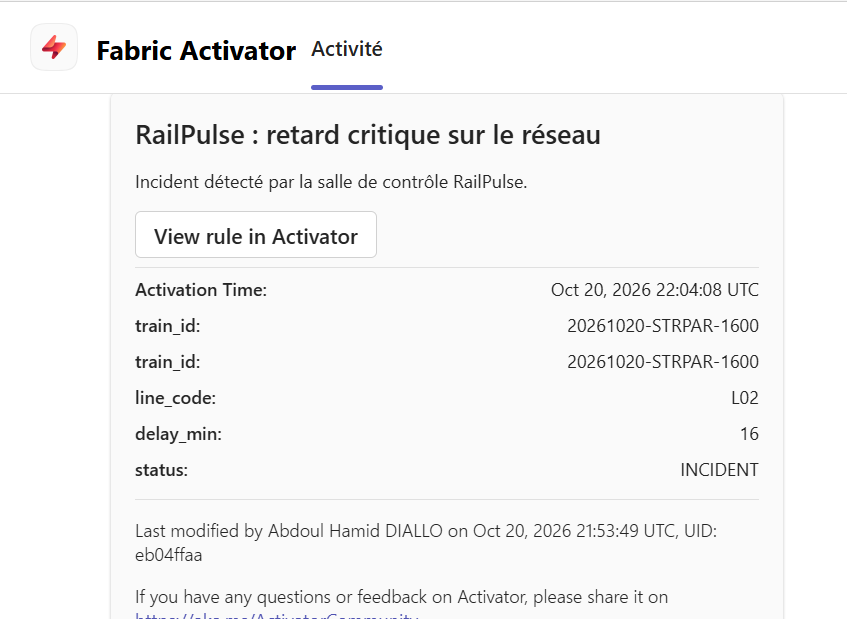

# ⚡ Temps réel : Eventstream, Eventhouse, KQL, tableau de bord et Activator

## Le chemin d'un signal

1. **`NB_04_Live_Simulator`** calcule la position de chaque train en circulation et envoie un événement JSON toutes les 3 secondes : `event_time`, `train_id`, `line_code`, `origin`, `destination`, `progress_pct`, `latitude`, `longitude`, `speed_kmh`, `delay_min`, `passengers`, `energy_kwh`, `status`. La nuit, il rejoue la pointe de 17 h 30 pour qu'il y ait toujours des trains sur le réseau.
2. **`ES_RailPulse_Live`** reçoit le flux sur un **point de terminaison personnalisé** (protocole Event Hub).
3. **`EH_RailPulse`** l'ingère dans la table `live_telemetry`, interrogeable à la seconde. La **disponibilité OneLake** expose cette table en Delta : un raccourci la rend lisible dans `LH_RailPulse_Silver`, en Spark comme en T-SQL, sans copie.
4. **`RTD_RailPulse_Control`** affiche la salle de contrôle, rafraîchie en continu.
5. **`ACT_RailPulse_Alerts`** (Activator) surveille un flux dérivé de l'Eventstream et envoie une alerte dans **Microsoft Teams** dès qu'un train dépasse 15 minutes de retard.

L'alerte donne l'heure d'activation, le train, la ligne, le retard et l'état : ici le train `20261020-STRPAR-1600` de la ligne L02, à 16 minutes de retard, pendant l'incident simulé.

## Fichiers

| Fichier | Contenu |
|---|---|
| `KQL_RailPulse_Controles.kql` | les trois requêtes de contrôle du guide : le flux arrive, le réseau en direct par ligne, l'incident de la ligne L02 |
| `KQL_RailPulse_Fonctions.kql` | les fonctions `RailClock()`, `LiveWindow(minutes)`, `LiveNetworkLatest()`, `LiveNetworkNow()`, la vue matérialisée `mv_line_minute` et une détection d'anomalies `series_decompose_anomalies` |
| `RTD_RailPulse_Control.kql` | les requêtes des 12 vignettes du tableau de bord, lisibles une à une |
| `RTD_RailPulse_Control.json` | la définition complète du tableau de bord (remplacez l'URI de requête et l'identifiant de la base KQL par les vôtres) |

## La salle de contrôle en 12 vignettes

Trains en circulation · retard moyen · retards critiques (> 15 min) · vitesse moyenne · voyageurs à bord · dernier signal reçu · carte de la dernière position de chaque train (bulle proportionnelle au retard) · trains à surveiller · retard moyen par ligne minute par minute · retard moyen par ligne · trains par état · arrêts en pleine voie.

**Le choix qui rend le tableau toujours lisible** : les vignettes ne filtrent pas sur `now()` mais sur `RailClock()`, l'heure du dernier signal reçu. Quand le simulateur tourne, le tableau est en direct ; quand il est arrêté, il montre la fin de la dernière session au lieu d'un écran vide.
